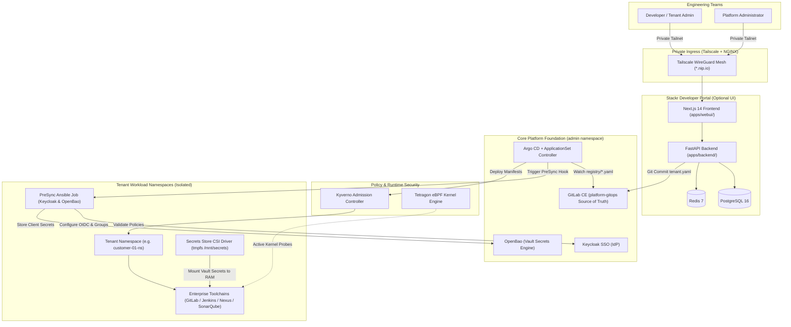

<div align="center">

# Stackr

### Modern Open-Source Internal Developer Platform (IDP) & Multi-Tenant GitOps Engine

**Turn infrastructure into self-service.** Provision complete, isolated DevOps environments with enterprise SSO, private networking, and Zero-Secret-on-Disk security in under 90 seconds.

<p align="center">
  <a href="#-quickstart-guide">Quickstart</a> •
  <a href="#-choose-your-deployment-mode">Deployment Modes</a> •
  <a href="#-high-level-architecture">Architecture</a> •
  <a href="./WRITEUP.md">Runbook (Phases 0–9)</a> •
  <a href="./CONTRIBUTING.md">Contribute</a>
</p>

<p align="center">
  <a href="https://github.com/KhalidNazih/Stackr/releases"></a>
  <a href="./LICENSE"></a>
  <a href="https://kubernetes.io/"></a>
  <a href="https://nextjs.org/"></a>
  <a href="https://fastapi.tiangolo.com/"></a>
  <a href="https://argo-cd.readthedocs.io/"></a>
  <a href="https://kyverno.io/"></a>
  <a href="https://tetragon.io/"></a>
</p>

</div>

---

> [!NOTE]
> **Open-Source Architectural Blueprint (v0.9.0):**  
> Stackr is currently optimized for Kubernetes clusters running on Azure (AKS) with Azure Key Vault auto-unseal and Tailscale private mesh ingress. Multi-cloud (AWS/GCP) and local sandbox setups are scheduled for v1.0.

---

## 🌟 Why Stackr?

Most platform engineering setups require weeks of manual glue code, complex Backstage plugins, or expensive SaaS subscriptions. **Stackr is batteries-included**, providing an automated, closed-loop GitOps machine with an enterprise security posture built-in:

<table>
  <tr>
    <td width="50%" valign="top">
      <h4>⚡ Self-Service in 90 Seconds</h4>
      <p>Developers and managers can provision isolated environments with pre-configured tools (GitLab, Jenkins, Nexus, SonarQube) via an interactive Developer Portal or by committing 1 YAML file to Git.</p>
    </td>
    <td width="50%" valign="top">
      <h4>🔒 Zero-Secret-on-Disk (ZSoD)</h4>
      <p>Secrets are projected directly from OpenBao into pod RAM (<code>tmpfs</code>) via the Secrets Store CSI Driver. Zero credentials are ever written to disk, Git, or plain etcd.</p>
    </td>
  </tr>
  <tr>
    <td width="50%" valign="top">
      <h4>🌐 Zero Public Attack Surface</h4>
      <p>Protected entirely behind encrypted <b>Tailscale WireGuard</b> VPN mesh networking and NGINX Ingress. The platform and its workloads are completely invisible to the public internet.</p>
    </td>
    <td width="50%" valign="top">
      <h4>🛡️ Defense-in-Depth Governance</h4>
      <p>Mandatory <b>Kyverno</b> admission controllers enforce pod security standards, while <b>Tetragon (eBPF)</b> kernel probes terminate unauthorized processes and protect secret mounts in real-time.</p>
    </td>
  </tr>
</table>

---

## 🎯 Choose Your Deployment Mode

Stackr features a **Headless-First** modular architecture. The Developer Portal (Web UI) is **completely optional**:

| Capability | 🤖 Mode 1: Headless GitOps Engine (Core) | 🖥️ Mode 2: Full IDP (+ Developer Portal) |
| :--- | :--- | :--- |
| **Interface** | Pure Git commits to `registry/*.yaml` | Next.js 14 Self-Service Visual Portal |
| **Kustomize Overlay** | `BaseServices/overlays/admin` | `BaseServices/overlays/admin_with_ui` |
| **Frontend Pod** | ❌ **Not deployed** (Saves CPU & RAM) | ✅ `webui` Pod running in `admin` namespace |
| **Backend API** | ✅ Platform synchronization engine | ✅ REST API powering the visual portal |
| **Target Audience** | Platform Engineers, DevOps, CI/CD automation | Software Engineers, Product Managers, Leads |

---

## 🏛️ High-Level Architecture



---

## 📦 Supported Toolchains & Services

Stackr provisions dedicated, isolated instances for each tenant team:

| Service | Category | Integration Highlights |
| :--- | :--- | :--- |
| **GitLab CE** | Source Control & CI/CD | Auto-provisioned with custom Ruby OIDC group sync hooks |
| **Jenkins** | Automation Server | Pre-configured with Jenkins Configuration-as-Code (JCasC) + RAM secret injection |
| **Nexus 3** | Artifact Repository | Integrated with `oauth2-proxy` sidecar for seamless Keycloak SSO |
| **SonarQube** | Code Quality & Security | SAML SSO authentication with automated PostgreSQL backend |
| **Custom Stack** | Pluggable | Extendable to Grafana, Harbor, Kafka, or databases via standard Helm templates |

---

## ⚡ Quickstart Guide

### 1. Clone & Configure
Clone the repository and run the interactive setup script:

```bash
git clone https://github.com/KhalidNazih/Stackr.git
cd Stackr
bash configure.sh
```
*The script prompts for your **Tailscale IP**, **Container Registry**, and **GitLab Group**, automatically replacing all environment placeholders across manifests.*

---

### 2. Deploy the Core Platform (Headless Mode)
Build the platform backend and deploy the core infrastructure via Kustomize:

```bash
# 1. Build & push the backend API
docker build -t <YOUR_PRIVATE_REGISTRY>/platform/backend:latest ./apps/backend
docker push <YOUR_PRIVATE_REGISTRY>/platform/backend:latest

# 2. Deploy headless core platform
kubectl apply -k BaseServices/overlays/admin
```

> Follow **[WRITEUP.md](./WRITEUP.md)** for initial OpenBao unsealing and Keycloak realm bootstrapping.

---

### 3. Deploy the Developer Portal (Optional UI Mode)
If your organization wants the self-service web interface:

```bash
# 1. Build & push the frontend UI
docker build -t <YOUR_PRIVATE_REGISTRY>/platform/frontend:latest ./apps/webui
docker push <YOUR_PRIVATE_REGISTRY>/platform/frontend:latest

# 2. Apply the full UI overlay
kubectl apply -k BaseServices/overlays/admin_with_ui
```

Your Developer Portal is now live on your private network at:  
👉 `http://platform.<YOUR_TAILSCALE_IP>.nip.io`

---

### 4. Onboard a Tenant in 1 Step

Start the ArgoCD tenant orchestrator:
```bash
kubectl apply -f system/ApplicationSet.yaml
```

To provision a new team, simply commit a manifest in `registry/` (e.g. `registry/team-alpha.yaml`):

```yaml
tenant_id: "team-alpha"
display_name: "Alpha Engineering"
business_unit: "Platform"
environment: "dev"
infrastructure:
  cluster_server: "https://kubernetes.default.svc"
isolation:
  namespace: "team-alpha-ns"
services:
  jenkins:
    enabled: true
    replicas: 1
  gitlab:
    enabled: true
  nexus:
    enabled: false
  sonarqube:
    enabled: false
access:
  groups:
    admins: "team-alpha-admins"
    users: "team-alpha-users"
  creator_email: "lead@example.com"
```

Push to GitLab. ArgoCD automatically generates the namespace, executes Keycloak SSO hooks, injects secrets, and launches the team's toolchains!

---

## 📁 Repository Structure

```
Stackr/
├── apps/
│   ├── webui/                     # Next.js 14 Developer Portal (TailwindCSS, Framer Motion)
│   └── backend/                   # FastAPI Python Platform Service (SQLAlchemy Async, Redis)
├── BaseServices/                  # Core platform infrastructure manifests
│   ├── base/                      # GitLab, Keycloak, OpenBao, Postgres, Redis, Security
│   └── overlays/
│       ├── admin/                 # Mode 1: Headless core platform deployment
│       └── admin_with_ui/         # Mode 2: Complete platform with Developer Portal UI
├── system/
│   └── ApplicationSet.yaml        # Argo CD ApplicationSet watching registry/*.yaml
├── templates/tenant-blueprint/    # Helm chart synthesizing tenant environments
│   ├── Chart.yaml                 # Helm chart metadata
│   ├── values.yaml                # Standard defaults for all tenant services
│   └── templates/                 # Ansible automation, toolchain manifests, CSI classes
├── registry/                      # Declarative tenant manifests (Source of Truth)
│   └── customer-01.yaml           # Canonical example tenant configuration
├── configure.sh                   # Interactive environment configuration script
├── WRITEUP.md                     # Comprehensive operations runbook (Phases 0–9)
├── CONTRIBUTING.md                # Guide for contributors & custom stack integrations
└── LICENSE                        # Apache 2.0 Open Source License
```

---

## 📖 Complete Operational Runbook

The complete step-by-step production runbook is documented in **[WRITEUP.md](./WRITEUP.md)**:

| Phase | Title | Description |
| :---: | :--- | :--- |
| **0** | **Cloud Infrastructure** | AKS cluster, ACR registry, and Key Vault setup |
| **1** | **Secure Networking** | Private Tailscale VPN operator & NGINX Ingress |
| **2** | **Core Bootstrap** | Deploying BaseServices with Kyverno & Tetragon eBPF |
| **3** | **Source of Truth** | GitLab initialization & platform-gitops repository |
| **4** | **The Brain** | Argo CD ApplicationSet controller & GitLab integration |
| **5** | **The Foundation** | OpenBao auto-unseal & Keycloak OIDC realm setup |
| **6** | **Secret Injection** | Zero-Secret-on-Disk token binding in OpenBao |
| **7** | **Tenant Lifecycle** | Tool integration (GitLab, Jenkins CasC, Nexus, Sonar) |
| **8** | **Tenant Onboarding** | Declarative registry onboarding and lifecycle |
| **9** | **Developer Portal** | Optional Next.js visual portal deployment & admin setup |

---

## 🧩 Extending Stackr (Add Your Own Tools)

Stackr is built to be extended. You can easily add **Grafana**, **Harbor**, **PostgreSQL**, **Kafka**, or custom company toolchains by following our step-by-step guide in **[CONTRIBUTING.md](./CONTRIBUTING.md#how-to-add-a-new-toolchain-to-the-tenant-blueprint)**.

---

## 🤝 Contributing & Community

Contributions are what make the open-source community an amazing place to learn, inspire, and create. Any contributions you make are **greatly appreciated**.

* Read our **[Contributing Guidelines](./CONTRIBUTING.md)** to get started.
* Review our **[Code of Conduct](./CODE_OF_CONDUCT.md)**.
* Found a bug? Open an **[Issue](https://github.com/KhalidNazih/Stackr/issues)**.

---

## 📄 License

This project is licensed under the **Apache License 2.0** — see the [LICENSE](./LICENSE) file for details.
