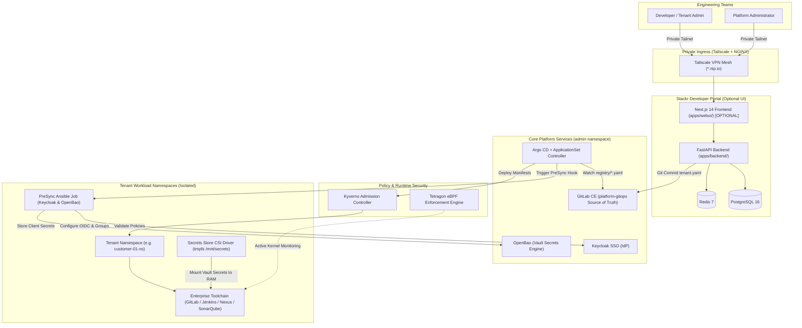

<div align="center">


# 🚀 Stackr: Production-Grade Internal Developer Platform (IDP) & Multi-Tenant GitOps Engine

[](https://github.com/KhalidNazih/Stackr/releases)
[](https://opensource.org/licenses/Apache-2.0)
[](https://kubernetes.io/)
[](https://nextjs.org/)
[-009688.svg?logo=fastapi&logoColor=white)](https://fastapi.tiangolo.com/)
[](https://argo-cd.readthedocs.io/)
[](https://kyverno.io/)
[](https://tetragon.io/)

> [!NOTE]
> **Open-Source Blueprint Notice (v0.9.0):**  
> Stackr is currently optimized for Kubernetes clusters running on Azure with Azure Key Vault auto-unseal and Tailscale private ingress. Multi-cloud (AWS/GCP) and local Kind setups are on the roadmap for v1.0.

**Stackr** is a self-service **Internal Developer Platform (IDP)** and **GitOps Automation Engine** designed for modern engineering organizations. It empowers development teams to provision isolated multi-tenant environments with enterprise DevOps toolchains (**GitLab**, **Jenkins**, **Nexus**, **SonarQube**) via a visual Developer Portal or purely declarative Git commits.

Built with a strict **"Security-First"** posture:
- **Zero-Secret-on-Disk (ZSoD)**: Secrets exist exclusively in pod RAM (`tmpfs`), never written to disk or etcd.
- **Identity Before Infrastructure (IBI)**: Dynamic Keycloak realm, group, and OIDC client configuration executes *before* any workload deploys.
- **Zero Public Exposure**: Protected entirely behind private **Tailscale** VPN mesh networking and NGINX Ingress.
- **Multi-Tenant Admission Governance**: Mandatory **Kyverno** admission policies enforce image provenance, non-root execution, and CPU/memory quotas.
- **Kernel-Level Runtime Enforcement**: Real-time **Tetragon (eBPF)** probes terminate unauthorized processes and protect secret RAM mounts.

---

## 🏛️ High-Level Architecture



---

## 🎯 Choose Your Deployment Mode

Stackr is built with a **Headless-First** modular architecture. The Developer Portal (Web UI) is **completely optional**:

| Capability | Mode 1: Headless GitOps Engine (Core) | Mode 2: Full IDP (+ Developer Portal) |
| :--- | :--- | :--- |
| **Interface** | Declarative Git commits to `registry/*.yaml` | Next.js Self-Service Web Portal |
| **Overlay** | `BaseServices/overlays/admin` | `BaseServices/overlays/admin_with_ui` |
| **Frontend Pod** | ❌ **Not deployed** (Saves CPU/RAM) | ✅ `webui` Pod running in `admin` |
| **Backend API** | ✅ Runs platform synchronization | ✅ Powers the Developer Portal |
| **Best For** | CI/CD automation, DevOps engineers | End-user self-service, engineering teams |

---

## ✨ Key Features

### 🖥️ Self-Service Developer Portal (`apps/webui/` & `apps/backend/`)
* **Role-Aware Dashboard**: Real-time cluster health, resource utilization, security events, and GitOps sync statuses.
* **Tenant Provisioning Wizard**: Interactive form allowing engineering managers to specify team access, enabled dev tools, and CPU/memory tiers. Automatically commits declarative `tenant.yaml` manifests to GitLab.
* **Live Services Directory**: Real-time inspection of Kubernetes pods, service health, endpoints, and status metrics across all tenant namespaces.
* **Admin Center**: Platform management portal for user role assignments, platform access control, and incident ticketing.

### ⚙️ Declarative GitOps Engine (`BaseServices/`, `registry/`, `system/`, `templates/`)
* **GitOps Registry**: The `registry/` directory serves as the definitive source of truth. Adding, modifying, or deleting a tenant YAML automatically triggers cluster reconciliation.
* **Argo CD ApplicationSets**: Dynamic synthesis of tenant applications from Helm blueprints (`templates/tenant-blueprint`).
* **Ansible PreSync Automation**: Automatically executes Keycloak API calls and Vault token exchanges before workloads are scheduled.
* **Headless Capability**: The platform can run 100% headless via Git commits alone, without deploying the Developer Portal.

---

## 📁 Repository Structure

```
stackr/
├── apps/
│   ├── webui/                     # Developer Portal Next.js 14 Web UI (OPTIONAL)
│   │   ├── app/                   # Next.js App Router (Dashboard, Tenants, Services, Admin)
│   │   ├── components/            # UI design system & branding components
│   │   ├── lib/                   # Keycloak SSO, API proxy, and state management
│   │   └── Dockerfile             # Multi-stage production container build
│   └── backend/                   # Platform API Service (FastAPI)
│       ├── api/                   # REST endpoints (tenants, services, auth, metrics)
│       ├── config.py              # Pydantic environment & OpenBao CSI settings
│       ├── main.py                # FastAPI application entrypoint
│       └── Dockerfile             # Python 3.12 slim container build
├── BaseServices/                  # Core platform infrastructure manifests
│   ├── base/                      # Shared deployments: GitLab, Keycloak, OpenBao, Postgres, Redis
│   │   ├── deployment/            # Service deployment specs
│   │   ├── pvcs/                  # Persistent storage definitions
│   │   ├── services/              # Internal ClusterIP definitions
│   │   └── security/              # Kyverno ClusterPolicies & Tetragon TracingPolicies
│   └── overlays/
│       ├── admin/                 # Mode 1: Headless core platform deployment
│       └── admin_with_ui/         # Mode 2: Complete platform with Developer Portal UI
├── system/
│   └── ApplicationSet.yaml        # Argo CD ApplicationSet watching registry/*.yaml
├── templates/tenant-blueprint/    # Helm chart synthesizing tenant environments
│   └── templates/
│       ├── automation/            # PreSync Ansible playbook & Job for Keycloak/OpenBao
│       ├── gitlab/                # Tenant GitLab CE instance with admin sync hook
│       ├── jenkins/               # Tenant Jenkins instance (JCasC + CSI RAM secret mount)
│       ├── nexus/                 # Tenant Nexus Repository Manager
│       ├── sonarqube/             # Tenant SonarQube code quality server
│       ├── ingress.yaml           # Tailscale ingress rules
│       └── SecretProviderClass.yaml# Vault CSI secret projection
├── registry/                      # Declarative tenant manifests (Source of Truth)
│   └── customer-01.yaml           # Example tenant configuration
├── configure.sh                   # Interactive environment setup script
├── WRITEUP.md                     # Comprehensive end-to-end operational deployment guide (Phases 0–9)
└── LICENSE                        # Apache 2.0 Open Source License
```

---

## ⚡ Quickstart Guide

### 1. Configure Your Environment
Clone the repository and run the automated configuration script:

```bash
git clone https://github.com/KhalidNazih/Stackr.git
cd Stackr
bash configure.sh
```

The script will prompt for your **Tailscale IP**, **Container Registry**, and **GitLab Group**, automatically replacing all environment placeholders across manifests.

### 2. Deploy Core Platform (Headless)
Build the platform backend and apply the base infrastructure via Kustomize:

```bash
# Build & push backend
docker build -t <YOUR_PRIVATE_REGISTRY>/platform/backend:latest ./apps/backend
docker push <YOUR_PRIVATE_REGISTRY>/platform/backend:latest

# Deploy headless core
kubectl apply -k BaseServices/overlays/admin
```

Follow **[WRITEUP.md](./WRITEUP.md)** for initial OpenBao Vault unsealing and Keycloak realm bootstrapping.

### 3. Deploy Developer Portal (Optional UI)
If you wish to provide your teams with a visual UI instead of running purely headless:

```bash
# Build & push frontend
docker build -t <YOUR_PRIVATE_REGISTRY>/platform/frontend:latest ./apps/webui
docker push <YOUR_PRIVATE_REGISTRY>/platform/frontend:latest

# Deploy with UI overlay
kubectl apply -k BaseServices/overlays/admin_with_ui
```

For full client-side variable injection and server-side secret binding, see **Phase 9 in [WRITEUP.md](./WRITEUP.md)**.

### 4. Onboard a Tenant
Start the Argo CD tenant orchestrator:

```bash
kubectl apply -f system/ApplicationSet.yaml
```

To create a new tenant, simply commit a file in `registry/`:

```yaml
tenant_id: "team-alpha"
display_name: "Alpha Engineering"
business_unit: "Platform"
environment: "dev"
infrastructure:
  cluster_server: "https://kubernetes.default.svc"
isolation:
  namespace: "team-alpha-ns"
services:
  jenkins:
    enabled: true
    replicas: 1
  gitlab:
    enabled: true
  nexus:
    enabled: false
  sonarqube:
    enabled: false
access:
  groups:
    admins: "team-alpha-admins"
    users: "team-alpha-users"
  creator_email: "lead@example.com"
```

Push the commit to GitLab. Argo CD and Ansible automatically handle Keycloak groups, Vault secret paths, and tenant toolchain provisioning.

---

## 🛡️ Security Baseline

| Layer | Implementation | Security Benefit |
| :--- | :--- | :--- |
| **Identity** | Keycloak OIDC/SAML | Centralized SSO, tenant RBAC, group claims |
| **Secrets** | OpenBao + Secrets Store CSI | Zero secrets stored in etcd or git; projected to RAM (`tmpfs`) |
| **Ingress** | Tailscale + NGINX | Zero public attack surface; encrypted wireguard VPN tunnel |
| **Admission** | Kyverno ClusterPolicies | Blocks public images, enforces non-root, mandates resource limits |
| **Kernel** | Tetragon eBPF | Active blocking of unauthorized binaries and FIM on `/mnt/secrets` |

---

## 📖 Complete Documentation

* **[WRITEUP.md](./WRITEUP.md)**: Comprehensive, step-by-step operations guide covering Phases 0 through 9 (Azure AKS initialization, Tailscale private ingress, Keycloak & OpenBao token configuration, tenant lifecycle, and optional Developer Portal deployment).

---

## 📄 License

This project is licensed under the [Apache License 2.0](./LICENSE).
